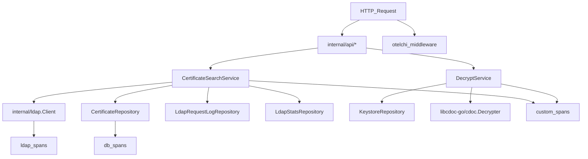

# Goal

Make `c:\WebROOT\TARKVARA.NEW\EWS\digisign-encrypt-go` a complete replacement for `c:\WebROOT\TARKVARA.NEW\Digisign\digisign-crypt` by porting missing behavior (DB + LDAP + decrypt + OTel) while keeping the existing HTTP surface consistent with `docs/API_PARITY.md`.

## What parity means (ground truth)

- **Java DB schema & behavior**: `digisign-crypt` persists certificates + LDAP request logs via Flyway migration `src/main/resources/db/migration/V1_0_0__create_certificate_and_ldap_tables.sql` and services like `CertificateStorageService`, `LdapRequestLogService`, `LdapStatisticsService`.
- **Java LDAP v2 semantics**: `ParallelLdapSearchService` returns per-server stats, persists certs, detects revocations (mark DB certs revoked when live server stops returning them), and returns **offline** cached certs for servers that are down.
- **Java health/stats endpoints**: `/api/health/ldap/`** and `/api/statistics/ldap/`**.
- **Go current gaps**:
  - `/api/decrypt/decrypt` is still `501 Not Implemented` in `internal/api/decrypt.go`.
  - No Postgres persistence layer or migrations equivalent to Java.
  - No LDAP health/statistics endpoints.
  - No v2 certificate endpoints that return per-server stats + DB offline fallback.
  - `openapi/openapi.yaml` is effectively empty for paths (and is not aligned with current handlers).

## Key design decisions already made (from you)

- **PKCS#12**: Move PKCS#12 bytes + password into **database** (no longer file-based).
- **Auth**: No auth yet; for now PKCS#12 lookup uses **only `asutusCode`** (but schema should allow later tightening to user+asutusCode).
- **OpenTelemetry**: Implement OpenTelemetry **fully** (HTTP ingress, internal ops, DB, LDAP spans; store trace_id/span_id in DB like Java).
- **Password storage**: Currently plaintext; implement in a way that’s easy to harden later (clear abstraction boundary; avoid logging secrets).

## Architecture (Clean boundaries)

- **Handlers** (`internal/api/`*): HTTP parsing/validation + response formatting.
- **Use-cases/services** (`internal/service/`*): orchestration (search+persist+revocation+decrypt).
- **Repositories** (`internal/storage/`*): Postgres CRUD and aggregations implemented via **GORM** (use `db.Raw()` only where needed for stats aggregations).
- **LDAP client** (`internal/ldap/`*): low-level LDAP search; called by service layer.
- **Observability** (`internal/observability/`*): OTel init + helpers; no business logic.

## Database implementation (parity + PKCS12-in-DB)

- Add SQL migrations to `digisign-encrypt-go` that mirror Java’s tables:
  - `certificates` (same columns + unique `(user_id_code, serial_number)`)
  - `ldap_request_log` (same columns including `trace_id`, `span_id`, plus denormalized year/month/day/week)
- Add new table for PKCS#12 storage (since you want PKCS#12 in DB):
  - `keystore_pkcs12` (proposal):
    - `id BIGSERIAL PK`
    - `asutus_code VARCHAR NOT NULL UNIQUE` (and optional `user_id` columns for later)
    - `pkcs12_bytes BYTEA NOT NULL`
    - `pkcs12_password TEXT NOT NULL` (plaintext for now; later swap to encrypted)
    - `active BOOLEAN NOT NULL DEFAULT TRUE`
    - timestamps
- Add indexes equivalent to Java’s intent (especially on `(request_year, request_month, request_day)` and `(request_year, request_week)` for stats).
- Implement `internal/storage` with **GORM**:
  - **Models** representing `certificates`, `ldap_request_log`, `keystore_pkcs12` (and future “user binding” columns).
  - **Repositories**:
    - `CertificateRepository`: upsert (by unique constraint), findByUserAndSource, markRevoked, cleanup (delete expired, purge revoked).
    - `LdapRequestLogRepository`: insert log rows with trace/span IDs.
    - `LdapStatisticsRepository`: daily/weekly/monthly/yearly aggregates matching Java responses (likely via `db.Raw()` for grouped aggregations).
    - `KeystoreRepository`: get PKCS12 bytes + password by `asutusCode` (plaintext for now; ensure never logged).

## LDAP v2 behavior (match Java)

- Introduce a service (e.g. `internal/service/ldapsearch`) that:
  - runs per-server searches in parallel
  - records per-server **duration**, **status** (SUCCESS/TIMEOUT/ERROR), and **cert count**
  - persists `ldap_request_log` for each server attempt, including **trace_id/span_id from current OTel span**
  - on success: upserts returned certificates into DB
  - detects revocations per server by comparing DB cached non-revoked certs vs live response and marking missing serials as revoked
  - for servers that are offline/error: loads cached active certs from DB and includes them in the v2 response

## Endpoints to add/finish in Go

### Decrypt

- Implement `/api/decrypt/decrypt` in `internal/api/decrypt.go`:
  - parse multipart CDOC file + JSON params (`asutusCode`, `slotId`, `password[]`)
  - **If `hsm.P11.active=true`**: build `key.PKCS11Config` using library/config paths + `slotId` + PIN derived from `password[]` and decrypt via `libcdoc-go` (`cdoc.Decrypter.WithPKCS11Token`).
  - **Else (PKCS#12 mode)**: fetch PKCS#12 bytes + password from DB by `asutusCode`, parse via `libcdoc-go/key.ParsePKCS12`, create token via `cdoc.NewPKCS12Token`, set on decrypter with `WithToken`, then decrypt.
  - return JSON structure matching `internal/dto/decrypt.go` (base64 content, metadata).

### LDAP health

- Add handlers analogous to Java:
  - `GET /api/health/ldap` (JSON overall + per-server statuses)
  - `GET /api/health/ldap/{serverName}`
  - `GET /api/health/ldap/ping` (plain text)

### LDAP statistics

- Add handlers analogous to Java:
  - `GET /api/statistics/ldap/daily/{date}` and `GET /api/statistics/ldap/daily`
  - `GET /api/statistics/ldap/weekly`, `/weekly/previous`, `/weekly/{year}/{week}`
  - `GET /api/statistics/ldap/monthly/{year}/{month}`
  - `GET /api/statistics/ldap/yearly/{year}`

### Certificate v2 endpoints

- Implement v2 search endpoints listed as pending in `[c:\WebROOT\TARKVARA.NEW\EWS\digisign-encrypt-go\docs\API_PARITY.md](c:\WebROOT\TARKVARA.NEW\EWS\digisign-encrypt-go\docs\API_PARITY.md)` using the new LDAP v2 service:
  - `/api/certificate/v2/search`, `/searchByCn`, `/searchByCnStarts`
  - ensure response includes per-server stats + offline cached certs, matching Java’s `LdapSearchResultV2` concept.

### Binary responses parity

- Update `internal/api/crypt.go` binary endpoints to always set `Response-Status-Code` + `Response-Status-Text` headers as required by `docs/API_PARITY.md` (also ensure consistent `LDAP.Active` gating).

## OpenTelemetry (full)

- Add OTel SDK initialization in `cmd/digisign-encrypt-go/main.go` (or wherever the server is started):
  - OTLP exporter (env-driven), resource attributes (service.name, version, environment)
  - tracer + meter providers + graceful shutdown
- Add HTTP instrumentation middleware (`otelchi`) to create spans per request and propagate W3C trace context.
- Add manual spans for:
  - per LDAP server search
  - DB operations (insert logs, upsert certs, stats queries)
  - decrypt operations (token source: PKCS11/PKCS12)
- Ensure `ldap_request_log.trace_id/span_id` are populated from the active span context.
- Ensure logs correlate with trace IDs (zap fields).

## OpenAPI generation

- Generate and serve an **OpenAPI 3.0** specification from Go code.
  - Keep the generator step in CI/release builds so the spec stays aligned with handlers.
  - Expose spec endpoints (Java-like):
    - `GET /v3/api-docs` (OpenAPI 3 JSON)
    - `GET /v3/api-docs.yaml` (OpenAPI 3 YAML)
  - Expose Swagger UI at `/swagger-ui`, `/swagger-ui/`, `/swagger-ui/index.html`, configured to load `/v3/api-docs`.
  - Implementation approach: reuse existing annotation pipeline if present (e.g., `swaggo/swag` output) and convert to OpenAPI 3 using a converter (e.g., `kin-openapi`), so the served spec is truly OAS3.

## Testing strategy (high-signal)

- **Integration tests first (Bamboo / Docker-enabled machine):**
  - Postgres-backed API integration tests for the critical parity surfaces:
    - `/api/decrypt/decrypt` (PKCS#12-from-DB path)
    - `/api/health/ldap/`**
    - `/api/statistics/ldap/**` (DB aggregations)
    - v2 certificate endpoints including offline fallback + revocation marking
  - Keep integration tests opt-in locally (e.g. build tag and/or env guard), because local machine has no Docker.
- **Unit tests to fill gaps (local-friendly):**
  - LDAP v2 orchestration (revocation detection, per-server stats) with mocked `internal/ldap.Client`.
  - Handler-level validation tests (multipart parsing, JSON params, error responses, required headers).

## Operational notes

- Prefer migrations run as a separate deploy step (or a dedicated `cmd/migrate`) rather than mandatory startup migrations, to align with component standards about long startup tasks.

## Sonar-friendly implementation checklist

- Keep functions small and cohesive; avoid duplication (extract shared helpers for response headers/status).
- Avoid logging secrets (PKCS#12 password, PIN, tokens); redaction by default.
- Always wrap errors with context (`fmt.Errorf("... %w", err)`).
- Prefer explicit input validation and early returns.
- Ensure consistent nil checks and no ignored errors.
- Add linting in CI (`golangci-lint`, `staticcheck`) so Sonar has fewer findings.

## Documentation (from zero)

- Add a full setup guide (likely `README.md` + `docs/`):
  - prerequisites and environment variables
  - Postgres schema/migrations and how to run them
  - PKCS#11 config (library/config path, slotId, PIN handling)
  - PKCS#12-in-DB management (how to insert/update keystores for an asutusCode)
  - running locally (without Docker) vs in Bamboo
  - curl examples for each endpoint (multipart + JSON form fields, binary responses)
  - Swagger UI locations and OpenAPI 3 spec URL(s)

## Files expected to change/add

- `digisign-encrypt-go/internal/api/decrypt.go` (implement)
- `digisign-encrypt-go/internal/api/`* (new ldap health/stats + cert v2 handlers)
- `digisign-encrypt-go/internal/config/config.go` (DB + OTel config)
- `digisign-encrypt-go/internal/service/`* (new use-cases)
- `digisign-encrypt-go/internal/storage/`* (GORM models + repositories)
- `digisign-encrypt-go/migrations/`* (SQL)
- `digisign-encrypt-go/cmd/.../main.go` (OTel init + wiring)
- `digisign-encrypt-go/docs/`* and `digisign-encrypt-go/README.md` (bootstrap + API usage docs)

## Follow-up (required by workspace rule)

- Add `docs/agent-memory.md` (it’s required by your Cursor rules but currently missing in these repos).

